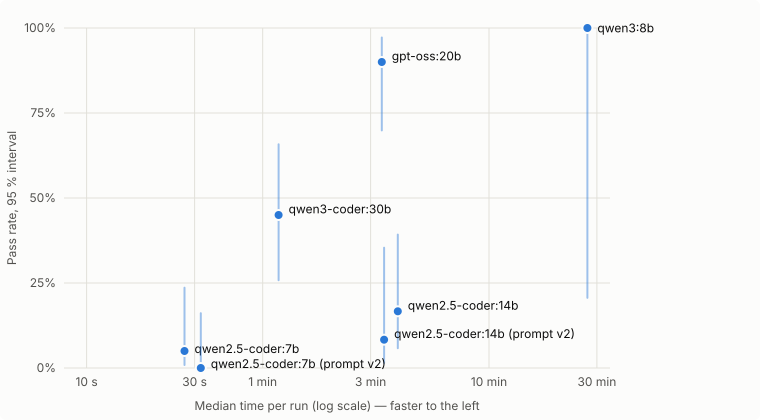

# LLM State-Consistency Audit — Leaderboard

_Generated 2026-10-24 by `run_audit.py` (prompt v1 unless the model name says otherwise). Do not hand-edit — rerun the audit instead._

A run **passes** only if its answer is within the scenario tolerance (0.01) of the reference. Anything else — a wrong number, a crash, a timeout or no code — fails.

| Rank | Model | ledger | portfolio | wallet | warehouse | Pass rate [95% CI] | pass@3 |
| ---: | :--- | :---: | :---: | :---: | :---: | ---: | ---: |
| 1 | Gemini 3.1 Pro Reasoning † | – | 1/1 | – | – | 100% [21%–100%] | – |
| 2 | qwen3:8b † | 1/1 | – | – | – | 100% [21%–100%] | – |
| 3 | gpt-oss:20b | 4/5 | 5/5 | 5/5 | 4/5 | 90% [70%–97%] | 100% |
| 4 | qwen3-coder:30b | 4/5 | 4/5 | 1/5 | 0/5 | 45% [26%–66%] | 65% |
| 5 | qwen2.5-coder:14b | 0/5 | 3/5 | 0/3 | 0/5 | 17% [6%–39%] | 25% |
| 6 | qwen2.5-coder:14b (prompt v2) | 0/3 | 1/3 | 0/3 | 0/3 | 8% [1%–35%] | 25% |
| 7 | qwen2.5-coder:7b | 0/5 | 1/5 | 0/5 | 0/5 | 5% [1%–24%] | 15% |
| 8 | qwen2.5-coder:7b (prompt v2) | 0/5 | 0/5 | 0/5 | 0/5 | 0% [0%–16%] | 0% |
| 9 | llama3.1:8b | 0/5 | 0/5 | – | 0/5 | 0% [0%–20%] | 0% |
| 10 | Baseline (partial drift) † | – | 0/1 | – | – | 0% [0%–79%] | – |

*Pass rate* pools every run of the model; the 95% Wilson interval shows how much it could move with more runs. *pass@3* is the unbiased estimate (Chen et al., 2021) of the chance that at least one of 3 attempts passes, averaged over scenarios with at least 3 runs.

† **Gemini 3.1 Pro Reasoning**: frozen output from before this harness existed; generated with an earlier, unpreserved prompt, not prompt v1.  
† **qwen3:8b**: reasoning model, 1 run only: on an 8 GB laptop GPU each run took ~27 minutes and ~16k output tokens (mostly thinking), so 5 runs per scenario was not practical.  
† **Baseline (partial drift)**: hand-written synthetic fixture, not a model. It applies holding-cost drift only after SELLs, to show the harness catches silent state bugs.  

## Prompt v1 vs v2

Prompt v2 adds one step of the simulation worked out by hand (`worked_example.md` in each scenario). Cells are v1 → v2 passes; pooled columns give the 95% Wilson interval.

| Model | Per scenario (v1 → v2) | Pooled v1 | Pooled v2 |
| :--- | :--- | ---: | ---: |
| qwen2.5-coder:14b | ledger 0/5 → 0/3; portfolio 3/5 → 1/3; wallet 0/3 → 0/3; warehouse 0/5 → 0/3 | 3/18 [6%–39%] | 1/12 [1%–35%] |
| qwen2.5-coder:7b | ledger 0/5 → 0/5; portfolio 1/5 → 0/5; wallet 0/5 → 0/5; warehouse 0/5 → 0/5 | 1/20 [1%–24%] | 0/20 [0%–16%] |

## Accuracy vs. time

Each point is a model that recorded its latency; the vertical bar is the 95 % Wilson interval of its pass rate. Up and to the left is better. Times are this laptop's (local models through Ollama).

## Cost and speed

Recorded by `generate.py` for each run (runs made before it recorded usage are left out). Local models cost nothing to call; latency depends on the hardware they ran on.

| Model | Runs | Median latency | Median output tokens | Total cost | Cost per passed run |
| :--- | ---: | ---: | ---: | ---: | ---: |
| qwen3:8b | 1 | 1634 s | 15,883 | $0.00 | $0.00 |
| gpt-oss:20b | 20 | 202 s | 3,852 | $0.00 | $0.00 |
| qwen3-coder:30b | 20 | 71 s | 1,501 | $0.00 | $0.00 |
| qwen2.5-coder:14b | 18 | 237 s | 1,218 | $0.00 | $0.00 |
| qwen2.5-coder:14b (prompt v2) | 12 | 207 s | 1,155 | $0.00 | $0.00 |
| qwen2.5-coder:7b | 5 | 27 s | 1,226 | $0.00 | no passes |
| qwen2.5-coder:7b (prompt v2) | 20 | 32 s | 994 | $0.00 | no passes |

## Reference answers

| Scenario | Answer |
| :--- | ---: |
| Bank ledger (`ledger`) | 6553.73 |
| Portfolio ledger (`portfolio`) | 17072.00 |
| Multi-currency wallet (`wallet`) | 2351.14 |
| Perishable warehouse (`warehouse`) | 622.67 |

## Failed runs

For every wrong answer the audit also runs the reference with each rule, and each pair of rules, switched off. If the answer matches one of those exactly, the detail names the rules the program most likely ignored.

| Model | Scenario | Run | Status | Answer | Expected | Detail |
| :--- | :--- | :--- | :--- | ---: | ---: | :--- |
| gpt-oss-20b | ledger | run_2 | wrong | 6543.71 | 6553.73 | off by -10.02 |
| gpt-oss-20b | warehouse | run_4 | wrong | 472.01 | 622.67 | off by -150.66 |
| qwen3-coder-30b | ledger | run_4 | wrong | 6543.71 | 6553.73 | off by -10.02 |
| qwen3-coder-30b | portfolio | run_2 | error | – | 17072.00 | `ValueError` |
| qwen3-coder-30b | wallet | run_1 | wrong | 2395.13 | 2351.14 | off by +43.99 |
| qwen3-coder-30b | wallet | run_2 | wrong | 2327.86 | 2351.14 | off by -23.28 · equals the answer without: premium spread |
| qwen3-coder-30b | wallet | run_3 | wrong | -45.00 | 2351.14 | off by -2396.14 |
| qwen3-coder-30b | wallet | run_4 | wrong | 2366.70 | 2351.14 | off by +15.56 |
| qwen3-coder-30b | warehouse | run_1 | wrong | 418.08 | 622.67 | off by -204.59 |
| qwen3-coder-30b | warehouse | run_2 | wrong | 418.08 | 622.67 | off by -204.59 |
| qwen3-coder-30b | warehouse | run_3 | wrong | 973.18 | 622.67 | off by +350.51 |
| qwen3-coder-30b | warehouse | run_4 | error | – | 622.67 | `RuntimeError` |
| qwen3-coder-30b | warehouse | run_5 | wrong | 973.18 | 622.67 | off by +350.51 |
| qwen2.5-coder-14b | ledger | run_1 | wrong | 7260.38 | 6553.73 | off by +706.65 |
| qwen2.5-coder-14b | ledger | run_2 | wrong | 6560.52 | 6553.73 | off by +6.79 |
| qwen2.5-coder-14b | ledger | run_3 | wrong | 18605.26 | 6553.73 | off by +12051.53 |
| qwen2.5-coder-14b | ledger | run_4 | wrong | -15.00 | 6553.73 | off by -6568.73 |
| qwen2.5-coder-14b | ledger | run_5 | error | – | 6553.73 | `UnboundLocalError` |
| qwen2.5-coder-14b | portfolio | run_3 | error | – | 17072.00 | `ValueError` |
| qwen2.5-coder-14b | portfolio | run_4 | wrong | 17090.31 | 17072.00 | off by +18.31 · equals the answer without: 2% wealth tax |
| qwen2.5-coder-14b | wallet | run_1 | wrong | 2336.15 | 2351.14 | off by -14.99 |
| qwen2.5-coder-14b | wallet | run_2 | wrong | 2385.13 | 2351.14 | off by +33.99 |
| qwen2.5-coder-14b | wallet | run_3 | wrong | 2336.15 | 2351.14 | off by -14.99 |
| qwen2.5-coder-14b | warehouse | run_1 | wrong | 166.70 | 622.67 | off by -455.97 |
| qwen2.5-coder-14b | warehouse | run_2 | wrong | 133.63 | 622.67 | off by -489.04 |
| qwen2.5-coder-14b | warehouse | run_3 | error | – | 622.67 | `NameError` |
| qwen2.5-coder-14b | warehouse | run_4 | error | – | 622.67 | `NameError` |
| qwen2.5-coder-14b | warehouse | run_5 | error | – | 622.67 | `ValueError` |
| qwen2.5-coder-14b-prompt-v2 | ledger | run_1 | error | – | 6553.73 | `NameError` |
| qwen2.5-coder-14b-prompt-v2 | ledger | run_2 | wrong | 7326.03 | 6553.73 | off by +772.30 |
| qwen2.5-coder-14b-prompt-v2 | ledger | run_3 | wrong | 7278.40 | 6553.73 | off by +724.67 |
| qwen2.5-coder-14b-prompt-v2 | portfolio | run_2 | wrong | 3749.96 | 17072.00 | off by -13322.04 |
| qwen2.5-coder-14b-prompt-v2 | portfolio | run_3 | error | – | 17072.00 | `NameError` |
| qwen2.5-coder-14b-prompt-v2 | wallet | run_1 | wrong | 2366.15 | 2351.14 | off by +15.01 · equals the answer without: monthly fee |
| qwen2.5-coder-14b-prompt-v2 | wallet | run_2 | wrong | 2336.15 | 2351.14 | off by -14.99 |
| qwen2.5-coder-14b-prompt-v2 | wallet | run_3 | wrong | 2366.15 | 2351.14 | off by +15.01 · equals the answer without: monthly fee |
| qwen2.5-coder-14b-prompt-v2 | warehouse | run_1 | error | – | 622.67 | `TypeError` |
| qwen2.5-coder-14b-prompt-v2 | warehouse | run_2 | error | – | 622.67 | `ValueError` |
| qwen2.5-coder-14b-prompt-v2 | warehouse | run_3 | wrong | 261.80 | 622.67 | off by -360.87 |
| qwen2.5-coder-7b | ledger | run_1 | wrong | 4424.00 | 6553.73 | off by -2129.73 |
| qwen2.5-coder-7b | ledger | run_2 | wrong | 6539.00 | 6553.73 | off by -14.73 |
| qwen2.5-coder-7b | ledger | run_3 | wrong | 865.00 | 6553.73 | off by -5688.73 |
| qwen2.5-coder-7b | ledger | run_4 | wrong | -3105.04 | 6553.73 | off by -9658.77 |
| qwen2.5-coder-7b | ledger | run_5 | wrong | 19345.00 | 6553.73 | off by +12791.27 |
| qwen2.5-coder-7b | portfolio | run_2 | error | – | 17072.00 | `NameError` |
| qwen2.5-coder-7b | portfolio | run_3 | error | – | 17072.00 | `AttributeError` |
| qwen2.5-coder-7b | portfolio | run_4 | error | – | 17072.00 | `TypeError` |
| qwen2.5-coder-7b | portfolio | run_5 | wrong | 17026.06 | 17072.00 | off by -45.94 |
| qwen2.5-coder-7b | wallet | run_1 | error | – | 2351.14 | `TypeError` |
| qwen2.5-coder-7b | wallet | run_2 | wrong | 180425.05 | 2351.14 | off by +178073.91 |
| qwen2.5-coder-7b | wallet | run_3 | error | – | 2351.14 | `AttributeError` |
| qwen2.5-coder-7b | wallet | run_4 | error | – | 2351.14 | `KeyError` |
| qwen2.5-coder-7b | wallet | run_5 | error | – | 2351.14 | `KeyError` |
| qwen2.5-coder-7b | warehouse | run_1 | error | – | 622.67 | `UnboundLocalError` |
| qwen2.5-coder-7b | warehouse | run_2 | error | – | 622.67 | `UnboundLocalError` |
| qwen2.5-coder-7b | warehouse | run_3 | error | – | 622.67 | `AttributeError` |
| qwen2.5-coder-7b | warehouse | run_4 | wrong | -384.10 | 622.67 | off by -1006.77 |
| qwen2.5-coder-7b | warehouse | run_5 | error | – | 622.67 | `UnboundLocalError` |
| qwen2.5-coder-7b-prompt-v2 | ledger | run_1 | wrong | 4412.25 | 6553.73 | off by -2141.48 |
| qwen2.5-coder-7b-prompt-v2 | ledger | run_2 | wrong | -1743.00 | 6553.73 | off by -8296.73 |
| qwen2.5-coder-7b-prompt-v2 | ledger | run_3 | error | – | 6553.73 | `AttributeError` |
| qwen2.5-coder-7b-prompt-v2 | ledger | run_4 | wrong | 6564.00 | 6553.73 | off by +10.27 |
| qwen2.5-coder-7b-prompt-v2 | ledger | run_5 | wrong | 6472.68 | 6553.73 | off by -81.05 |
| qwen2.5-coder-7b-prompt-v2 | portfolio | run_1 | error | – | 17072.00 | `IndexError` |
| qwen2.5-coder-7b-prompt-v2 | portfolio | run_2 | error | – | 17072.00 | `IndexError` |
| qwen2.5-coder-7b-prompt-v2 | portfolio | run_3 | wrong | 3749.96 | 17072.00 | off by -13322.04 |
| qwen2.5-coder-7b-prompt-v2 | portfolio | run_4 | error | – | 17072.00 | `UnboundLocalError` |
| qwen2.5-coder-7b-prompt-v2 | portfolio | run_5 | error | – | 17072.00 | `decimal.InvalidOperation` |
| qwen2.5-coder-7b-prompt-v2 | wallet | run_1 | error | – | 2351.14 | `KeyError` |
| qwen2.5-coder-7b-prompt-v2 | wallet | run_2 | error | – | 2351.14 | `KeyError` |
| qwen2.5-coder-7b-prompt-v2 | wallet | run_3 | wrong | 2342.86 | 2351.14 | off by -8.28 · equals the answer without: premium spread, monthly fee |
| qwen2.5-coder-7b-prompt-v2 | wallet | run_4 | wrong | 11597.67 | 2351.14 | off by +9246.53 |
| qwen2.5-coder-7b-prompt-v2 | wallet | run_5 | error | – | 2351.14 | `NameError` |
| qwen2.5-coder-7b-prompt-v2 | warehouse | run_1 | error | – | 622.67 | `KeyError` |
| qwen2.5-coder-7b-prompt-v2 | warehouse | run_2 | error | – | 622.67 | `ValueError` |
| qwen2.5-coder-7b-prompt-v2 | warehouse | run_3 | error | – | 622.67 | `AttributeError` |
| qwen2.5-coder-7b-prompt-v2 | warehouse | run_4 | wrong | 0.00 | 622.67 | off by -622.67 |
| qwen2.5-coder-7b-prompt-v2 | warehouse | run_5 | error | – | 622.67 | `UnboundLocalError` |
| llama3.1-8b | ledger | run_1 | wrong | 3798.00 | 6553.73 | off by -2755.73 |
| llama3.1-8b | ledger | run_2 | wrong | 5449.00 | 6553.73 | off by -1104.73 |
| llama3.1-8b | ledger | run_3 | wrong | 8450.00 | 6553.73 | off by +1896.27 |
| llama3.1-8b | ledger | run_4 | error | – | 6553.73 | `SyntaxError` |
| llama3.1-8b | ledger | run_5 | wrong | 6570.76 | 6553.73 | off by +17.03 |
| llama3.1-8b | portfolio | run_1 | wrong | -8733.49 | 17072.00 | off by -25805.49 |
| llama3.1-8b | portfolio | run_2 | error | – | 17072.00 | `SyntaxError` |
| llama3.1-8b | portfolio | run_3 | wrong | 29388.35 | 17072.00 | off by +12316.35 |
| llama3.1-8b | portfolio | run_4 | error | – | 17072.00 | `IndexError` |
| llama3.1-8b | portfolio | run_5 | error | – | 17072.00 | `AttributeError` |
| llama3.1-8b | warehouse | run_1 | error | – | 622.67 | `IndexError` |
| llama3.1-8b | warehouse | run_2 | error | – | 622.67 | `TypeError` |
| llama3.1-8b | warehouse | run_3 | error | – | 622.67 | `AttributeError` |
| llama3.1-8b | warehouse | run_4 | error | – | 622.67 | `KeyError` |
| llama3.1-8b | warehouse | run_5 | wrong | 771.53 | 622.67 | off by +148.86 |
| baseline-partial-drift | portfolio | run_1 | wrong | 17035.94 | 17072.00 | off by -36.06 |
